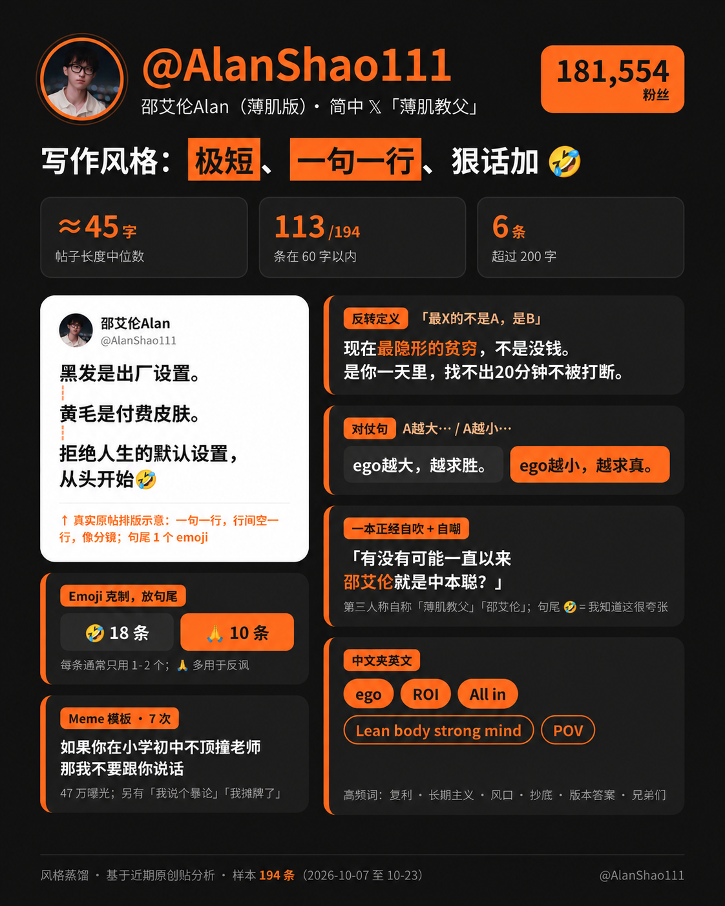

# 邵艾伦 Alan · 写作人格 Skill

**短句、狠话、自嘲。读完想动起来。**

聊健身，最后聊到自律；聊消费，最后聊到复利；聊 AI，最后聊到个人影响力。邵艾伦的内容有一条很鲜明的主线：**拒绝人生的默认设置，把选择权拿回自己手里。**

这套 Skill 把他的选题、思维模型、句式和语气整理成可调用的写作方法。给它一个主题、一段草稿，或一条你憋了很久的想法，让 AI 帮你写出有冲突、有节奏、能落地的中文短帖。

> 「完美主义最阴险的地方：让一个作品为0的人，永远觉得自己是天才。」
>
> —— 邵艾伦，[原帖](https://x.com/AlanShao111/status/2110702226322911358)



## 这股“邵艾伦味”从哪来？

**第一句就出拳。** 判断、反差、重新下定义，先把读者从习惯里拽出来。铺垫可以删，观点要站得住。

**一句一行，像打拍子。** 样本里短帖的长度中位数约 45 字。每行推进一点，最后一句收住；少量 emoji 给夸张留一个自嘲的出口。

**身体、钱、注意力，经常放在同一张桌上算账。** 今天的训练、今天少花的钱、今天交出的作品，都能成为他谈复利的入口。

**敢说，也会拿自己开玩笑。** “暴论”的锋芒、具体场景的反差、一本正经的夸张，组合出一种自信又不端着的语气。

**最后给你一个动作。** 发第一版、留半小时、练一次、把作品交出去。读者能马上开始，文字就有了后劲。

## 它脑子里有哪几条主线？

| 主线 | 怎么变成内容 |
|---|---|
| 拒绝默认设置 | 从“大家都这样”里，找出值得重新选择的那一件事 |
| 自律与第一次赢 | 用一个具体的小胜利，打开长期行动的入口 |
| 复利与延迟反馈 | 写清今天的动作，会给未来留下什么 |
| 个人 IP 与影响力 | 把真实经历变成作品，再让作品积累信任 |
| small ego 与反完美主义 | 给空想一个交付期限，让现实来反馈 |

这些是选题与表达的抓手。具体经历、数字和立场仍来自你。

## 先试这几个题

**给拖延的人来一点推力：**

```text
使用 $alanshao111-style，围绕“教程看了很多，第一个作品还没发”写 5 条短帖。
观点要狠一点，别羞辱读者，每条 60 字以内。
```

**把你的经历写出记忆点：**

```text
使用 $alanshao111-style，把我这段经历写成 3 条短帖。
分别从注意力、复利和行动三个角度切入，只使用我提供的事实：
[贴入你的经历]
```

**把一段长草稿压出力量：**

```text
使用 $alanshao111-style，改写下面这段话。
保留原意，一句一行，删掉铺垫，结尾落到一个今天就能做的动作：
[贴入草稿]
```

## 大概会写出这样的东西

主题：收藏了很多教程，迟迟不开始。

> 收藏夹已经满了。
>
> 第一条作品，还没上线。
>
> 今天先发一个粗糙版本。
>
> 给现实一个回复你的机会。

主题：做内容，总觉得自己没准备好。

> 草稿里的你，永远发挥稳定。
>
> 发出去，才知道哪里需要练。
>
> 今天交卷。🤣

以上是本项目的原创演示。默认给 3 个不同切入角度的版本；字数、数量、语气都可以按你的要求调整。

## 和 Morris 那套，怎么选？

想让观点更有冲击力、让读者动起来，可以用这一套。想把处境、资源和因果关系讲透，可以试试 [Morris 写作人格 Skill](https://github.com/badboywzw/morris-lt-style)。同一个题，也可以交给两套 Skill 各写一遍。

## 装好就能用

下载本仓库，把整个 `alanshao111-style` 文件夹放进你的 Codex 用户 Skill 目录，通常是 `~/.codex/skills/`；设置了 `CODEX_HOME` 时使用它下面的 `skills/`。然后在新对话里调用 `$alanshao111-style`。

也可以先克隆：

```sh
git clone https://github.com/badboywzw/alanshao111-style.git
```

Windows 用户可在下载后的仓库目录运行安装脚本，自动放入当前用户的 Skill 目录：

```powershell
powershell -NoProfile -ExecutionPolicy Bypass -File .\install.ps1
```

已有自定义存储位置时，可用 `-SkillRoot` 指定。脚本不会覆盖内容不同的已有安装。

## 这套方法怎么来的？

基于用户提供的 **194 条原创帖蒸馏报告**，样本时间为 **2026-10-07 至 2026-10-23**。正好覆盖播客发布与薄肌俱乐部扩张期，所以相关话题的权重可能偏高。图中的粉丝数、互动和字数都是该次报告的历史快照，本项目未独立核验。

- [SKILL.md](SKILL.md)：真正供 AI 调用的写作方法。
- [写作手册](references/writing-playbook.md)：句式、改写路径和更多原创示例。
- [完整蒸馏报告](references/source-report.md)：人物画像、11 条思维模型、表达风格与爆款规律，保留原帖出处。

这是独立整理的风格研究项目。生成内容使用你自己的身份与事实；引用原帖会标明出处。原报告里的角色提示词作为资料保留，不直接执行。图片由用户提供，原帖、图片及作者标识的权利归各自权利人。
